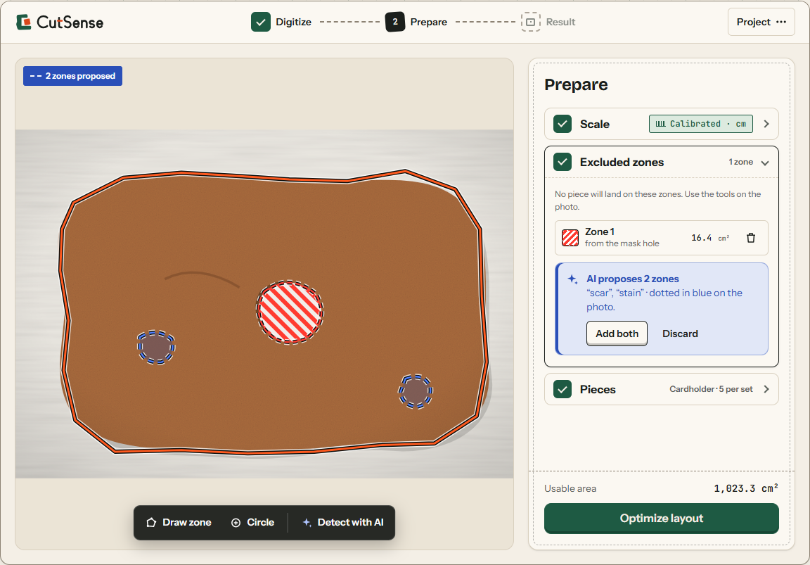
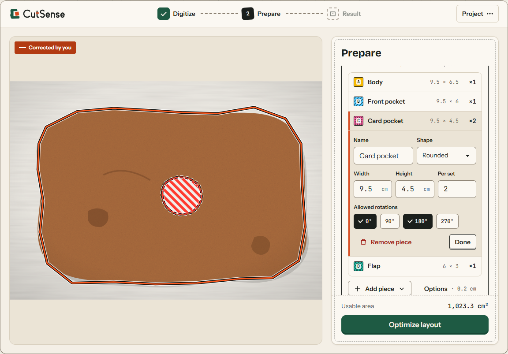
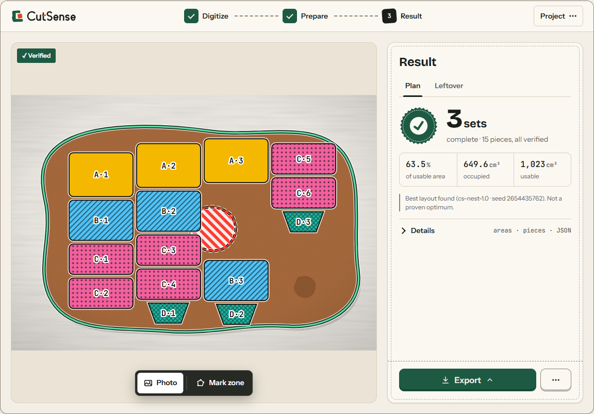
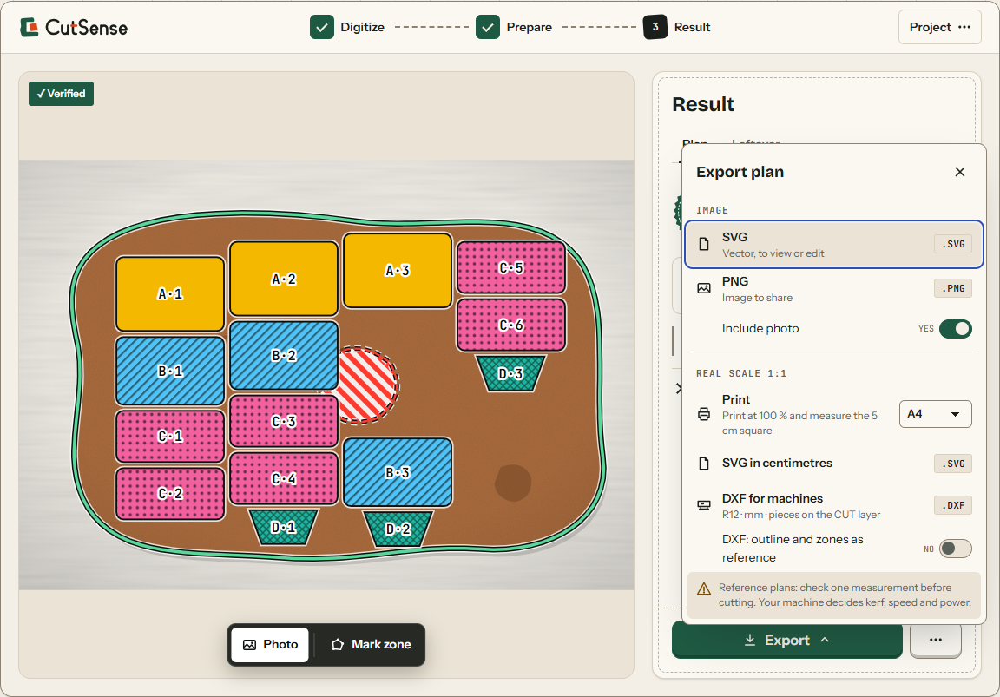
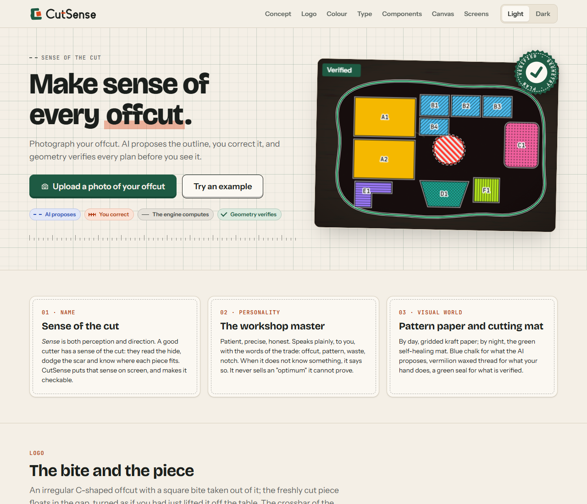
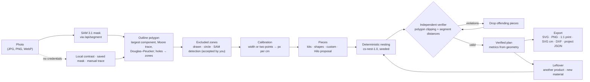

<p align="center">
  
</p>

<p align="center"><b>Make sense of every offcut.</b><br>
From a photo of an irregular scrap to a cutting plan you can trust.</p>

---

CutSense turns a photo of an irregular flat offcut (leather, felt, foam, cardboard) into a verified cutting plan. Photograph the scrap, let AI outline it, mark the defects, choose what you want to make, and get a layout that a geometric verifier has checked before you see it. Export it as an image, print it at real scale across sheets of paper, or send a DXF to a cutting machine.

The idea behind it is simple: **AI proposes, deterministic code places and verifies, you decide.** Segmentation and the design assistant are AI. Placement, verification, metrics and exports are plain, reproducible geometry.

## Contents

- [What it does](#what-it-does) and [what it does not do](#what-it-does-not-do)
- [Features](#features)
- [Screenshots](#screenshots)
- [Quick start](#quick-start)
- [Architecture](#architecture)
- [Project layout](#project-layout)
- [API at a glance](#api-at-a-glance)
- [Security and privacy](#security-and-privacy)
- [Roadmap and known limits](#roadmap-and-known-limits)
- [Documentation](#documentation)
- [Contributing and license](#contributing-and-license)

## What it does

1. **Digitize.** SAM 3.1 (Meta Model API) proposes a mask of your material from a short phrase such as "brown shape", or from guide points. The mask becomes an editable polygon; holes in it are suggested as excluded zones. You accept, edit vertex by vertex, or trace by hand.
2. **Prepare.** A three-item checklist: **Scale** (calibrate with the material's real width or with two points on a known length), **Excluded zones** (draw them, drop a circle, or ask SAM to detect defects), and **Pieces** (ready-made kits, basic shapes, your own drawn or imported shapes, or a design worked out with Hilo, the AI pattern maker).
3. **Result.** A deterministic nesting engine places the pieces and an independent verifier checks the plan. You see a verified plan, how much of the usable area it occupies, and what (if anything) did not fit. Then you export it, try another product on the leftover, or plan the next batch on a leftover fragment.

## What it does not do

CutSense is honest about its limits, and so is this README:

- **No proven optimum.** The plan is the best one a seeded heuristic search found within its budget. It is verified to be *valid*, not proven to be *optimal*.
- **No industrial accuracy.** Exports are reference drawings. Accuracy depends on the calibration and on the photo being taken from nearly straight above; strong perspective makes the scale unreliable. Kerf, speed and power are your machine's business.
- **No measured savings.** The app reports the area it occupies; it does not claim cost or waste savings.
- **No accounts, no cloud storage.** Projects live in your browser session and in files you choose to save.
- **AI output is a proposal.** SAM can miss stains it treats as material, and Hilo's measurements are a starting point you review before cutting.

## Features

| Area | What you get |
|---|---|
| **Outline with SAM 3.1** | Live segmentation by phrase or by positive/negative guide points, through a server proxy. The largest component is traced (Moore neighbourhood) and simplified (Douglas–Peucker). Holes in the mask become proposed excluded zones. Every outline is labelled with its source (*AI, SAM 3.1*, *saved example mask*, *local contrast segmentation*, *manual trace*, *leftover*) and with *+ your correction* when edited. |
| **Offline alternatives** | Local contrast segmentation (in the browser, not AI), the stored mask of each example, and manual tracing. The app still works without credentials and says clearly that AI segmentation did not run. |
| **Defect detection** | Ask SAM for short phrases ("scar, stain, hole"). Proposals are drawn dashed and only become excluded zones when you accept them. |
| **Calibration** | Quick calibration by the material's real width, or two points on a known length (a bank card is 8.56 cm long). Without it, sizes are relative units (1 u = 1 % of the image width), never centimetres. |
| **Kits and single pieces** | Leather cardholder (5 pieces), leather bifold wallet (7 pieces), and single pieces repeated as many times as they fit: keychains, coasters, bookmarks. Kits use real centimetres and require a calibration in cm. |
| **Maximize complete sets** | In **Complete sets** mode the order is one set (one wallet, say) and CutSense searches for the largest number of *complete* sets that fit. Partial sets never count. |
| **Leftover reuse** | The **Leftover** tab shows what remains (material minus pieces and defects). Use a fragment as the new material, or upload a photo of the real leftover after cutting; your order is kept. |
| **Make another product from the leftover** | Fit a kit or single piece, with an optional quantity, around the pieces already placed. The combined plan is verified as a whole, and each added product can be removed. |
| **Custom pieces** | Draw a shape on a small canvas, or import the largest closed shape from an SVG (curves are sampled into polygons; the real width is read from the SVG's `width`/`viewBox`). Up to 6 piece types per order. |
| **Exports** | Verified plan as SVG or PNG (with or without the photo). With a calibration in cm or mm: a 1:1 print layout tiled across A4 or Letter sheets with overlap marks, a 5 × 5 cm scale check and per-piece templates; a 1:1 SVG in centimetres; and a DXF (R12, millimetres, pieces on a `CUT` layer, optional `MATERIAL`/`DEFECTS` reference layers). |
| **Save and open projects** | One JSON file holds the photo, outline, zones, calibration, order and plan (Ctrl/Cmd+S). On open, the file is strictly validated and the plan is verified again; a plan that no longer passes is dropped, not shown. |
| **Reproducibility** | Every result carries the seed and optimizer version (`cs-nest-1.0`). "Download problem + solution (JSON)" saves the exact input and output. |
| **Hilo, the AI pattern maker** | A design chat (Muse Spark via the Meta Model API) that asks one question at a time with quick replies, reads sketches, and proposes flat pieces with sizes and quantities as strictly validated data. Nothing is applied until you approve it. When a plan cannot fit even one complete product, Hilo can be opened with a diagnosis already written. |
| **3D assembly preview** | Each proposal comes with an approximate 3D model of how the pieces fold and assemble, built from the real piece sizes, reviewed by the model against a render, and checked deterministically before it is revealed. See [docs/3d-preview.md](docs/3d-preview.md). |
| **Accessible UI** | Light and dark themes, keyboard paths, colour never used alone (pieces carry colour + pattern + letter), polite live announcements, reduced-motion support. Hilo answers in the language you write in. |

## Screenshots

| Prepare: excluded zones proposed by SAM | Prepare: editing a kit piece |
|---|---|
|  |  |

| Result: 3 complete sets, verified | Result: export menu |
|---|---|
|  |  |

| 3D assembly preview (bifold wallet) | Landing page |
|---|---|
|  |  |

More: the 3D preview sheets for every product family live in [`docs/3d-preview/`](docs/3d-preview/), and the brand and UX captures in [`design/screenshots/`](design/screenshots/) and [`design/ux/screenshots/`](design/ux/screenshots/).

## Quick start

### Requirements

- **Node.js 22.9 or newer.** The API scripts use Node's `--env-file-if-exists` flag (through `tsx`).
- npm (a `package-lock.json` is included).
- Optional: a Meta Model API key for SAM 3.1 segmentation, Hilo and the 3D preview. Everything else works without it.

### Install and configure

```bash
npm install
cp .env.example .env    # then add your credentials (optional)
```

| Variable | Default | Used by | Description |
|---|---|---|---|
| `SAM_API_URL` | *(empty)* | segmentation, Hilo, 3D preview | Meta Model API base URL, e.g. `https://api.meta.ai/v1`. Segmentation calls `<base>/responses`; Hilo and the 3D preview call `<base>/chat/completions`. |
| `SAM_API_KEY` | *(empty)* | all AI routes | API key, sent as a Bearer token. Read only by the server. |
| `SAM_MODEL` | `sam-3.1` | segmentation | Segmentation model id. |
| `AGENT_MODEL` | `muse-spark-1.3` | Hilo, 3D preview | Chat model id for the design agent and the assembly preview. |
| `PORT` | `8787` | API server | Port of the Express API. |

Without `SAM_API_URL` and `SAM_API_KEY`, the AI routes answer `503 *_NOT_CONFIGURED` and the UI offers the labelled alternatives (example mask, local contrast segmentation, manual tracing, kits and hand-made pieces).

### Run

```bash
npm run dev         # web (Vite, http://localhost:5173) + API (http://localhost:8787), with reload
npm run dev:web     # web only
npm run dev:api     # API only
```

Vite proxies `/api` to `http://localhost:8787`, so open **http://localhost:5173**. The dev server also serves the 3D preview lab at `/assembly-lab.html` (development only).

### Build, preview and test

```bash
npm run build       # type-check (tsc --noEmit) + production bundle in dist/
npm run preview     # serve the built bundle with Vite
npm start           # run the API server without watch mode
npm test            # vitest: engine, verifier, exports, project files, agent schema, 3D scene, server routes
```

`npm run preview` serves the static bundle; for the AI features run the API too (`npm start`) and make sure `/api` reaches it (Vite's preview server uses the same proxy settings, or put both behind your own reverse proxy).

## Architecture



- **The model proposes, geometry decides.** SAM proposes an outline and defect zones; Hilo proposes pieces; the 3D model proposes an assembly. Each proposal is data, validated against strict limits and reviewed by you. Placement, verification, metrics and exports are deterministic code.
- **Two independent geometric paths.** The optimizer decides fit with point-in-polygon tests, an occupancy raster and segment distances with a safety margin. The verifier never reuses that code: it measures containment, defect invasion and overlap as *areas* of boolean operations (polygon-clipping) and spacing as exact segment-to-segment distances. Every candidate plan passes the verifier before it can become the result.
- **Metrics are recomputed from geometry**, never taken from optimizer counters.
- **Units.** Geometry runs in image pixels. The UI shows relative units (1 u = 1 % of the image width) until you calibrate; then it shows the calibrated unit (cm or mm). Kits, Hilo, 1:1 print and DXF require a physical calibration.

Read more in [docs/architecture.md](docs/architecture.md) and [docs/engine.md](docs/engine.md).

## Project layout

```
cut-sense/
├── index.html               App entry
├── assembly-lab.html        3D preview lab (dev server only, not in the production build)
├── server/                  Express API: SAM proxy, Hilo, 3D assembly routes (+ tests)
│   ├── index.ts             /api/health, /api/segment, /api/agent; rate limit; env vars
│   ├── agent.ts             Hilo: system prompt, history checks, structured output, retry
│   └── assembly.ts          /api/assembly, /critique, /align: prompts, limits, validation
├── src/
│   ├── engine/              Pure geometry (no DOM): optimizer, kit search, verifier, metrics, leftover (+ tests)
│   ├── lib/                 Mask → polygon, SAM client, kits, exports (SVG/PNG/print/DXF), project file,
│   │   │                    agent schema and client, Markdown subset, custom pieces, SVG import
│   │   └── assembly/        3D scene language, validation, archetype macros, kinematics, sanity checks
│   ├── viewer3d/            three.js renderer, loaded on demand
│   ├── components/          React UI: Home, Workspace, Stage (SVG canvas), Hilo dialog, 3D preview
│   │   └── workspace/       Workspace controller hook (useWorkspace) and its panels, menus and toolbar
│   ├── dev/                 3D preview lab entry
│   ├── brand/               Brand tokens and components used by the app
│   ├── state.ts             Project / Result model, units, problem building, plan diffs
│   └── types.ts             Shared contract: Problem, Template, Placement, Solution, Metrics, Violation
├── design/                  Brand book, logos, tokens, components, living style guide, UX redesign
├── docs/                    Product and developer documentation
└── public/                  Favicon and static assets
```

## API at a glance

All routes take and return JSON (request bodies up to 12 MB). Error bodies are `{ code, message }`.

| Route | Purpose | Limits |
|---|---|---|
| `GET /api/health` | Which AI features are configured, and the model ids | none |
| `POST /api/segment` | SAM 3.1 mask for a phrase or guide points (largest mask, or every mask with `all: true`) | 45 s timeout · up to 16 points · 20 masks |
| `POST /api/agent` | One Hilo turn: a question, a proposal or a redirect, schema-validated | 20 requests/min per IP · 60 s timeout |
| `POST /api/assembly` | 3D assembly scene for a set of pieces | 30 requests/min per IP (shared by the three assembly routes) · 90 s |
| `POST /api/assembly/critique` | Model review of a rendered scene: `ok` or a corrected scene | same |
| `POST /api/assembly/align` | Final fix for problems the geometric checks still measure | same |

Full request and response shapes, error codes and limits: [docs/api.md](docs/api.md).

## Security and privacy

- **The API key stays on the server.** The browser only talks to `/api/*`; credentials are read from environment variables by `server/` and never sent to the client.
- **Model output is data, never code.** Hilo and the 3D preview use structured output against closed JSON Schemas, then a second, stricter validation (ranges, enums, counts, exactly one question per turn, known piece names). Invalid output gets one retry with the error, then a clear error code. Hilo's replies render through a safe Markdown subset (no raw HTML; only `http(s)` links).
- **Prompt-injection guardrails.** Messages, sketches, product names, assumptions and geometry reports are passed to the model as data. Hilo declines requests outside designing flat-piece objects and ignores instructions to change its rules.
- **Input limits.** Image types and sizes are checked on both sides (photos ≤ 10 MB in the browser; sketches PNG/JPEG/WebP, 3 per conversation, ≤ ~1.5 MB each after encoding; critique images ≤ 1.2 MB). Conversation length, message size and piece counts are capped.
- **Rate limits.** In-memory, per process and per client IP: 20 Hilo turns per minute and 30 assembly calls per minute. `/api/segment` has no rate limit of its own, and the limiter uses Express's `req.ip`; if you deploy behind a reverse proxy, configure `trust proxy` and add limits at the proxy.
- **Project files are not trusted.** Opening a project validates every field (types, ranges, sizes, embedded image format, 40 MB cap) and re-runs the verifier on the saved plan. A tampered or outdated plan is discarded.
- **Where your data goes.** Photos are sent to the Meta Model API for segmentation; Hilo messages, sketches and 3D renders are sent to it for the design and preview features. Nothing is stored by the CutSense server. A saved project file contains your photo, so treat it as private.

## Roadmap and known limits

Known limits today:

- Single sheet of material per plan; no multi-sheet nesting.
- Rotations are restricted to 0°, 90°, 180° and 270° per piece.
- The search budget is time-based (4 s for a fixed order, 8 s for complete sets). Results are deterministic for the same input and seed, but a much slower machine may explore fewer passes and find a different plan.
- At most 6 piece types per order and 400 piece instances per optimization.
- Defects that SAM sees as material must be drawn by hand.
- Two-point calibration assumes a near top-down photo.
- The 3D preview is an approximation: uniform thickness, ideal folds, symbolic stitches; garments are shown flat.

On the roadmap:

- Natural-language order entry that turns requests into structured, confirmed constraints.
- Multi-sheet nesting and more machine formats.
- Share links for projects.

## Documentation

| Document | Topic |
|---|---|
| [docs/architecture.md](docs/architecture.md) | Modules, data flow, units, the Project/Result state model, why AI proposes and code decides |
| [docs/engine.md](docs/engine.md) | Nesting heuristic `cs-nest-1.0`, complete-set search, verifier guarantees, leftover |
| [docs/api.md](docs/api.md) | Every endpoint: shapes, error codes, rate limits, timeouts, env vars |
| [docs/agent.md](docs/agent.md) | Hilo: conversation rules, quick replies, sketches, schema, guardrails |
| [docs/3d-preview.md](docs/3d-preview.md) | 3D assembly preview: scene language, review loop, checks, limits |
| [docs/exports-and-formats.md](docs/exports-and-formats.md) | SVG, PNG, 1:1 printing, DXF, project JSON, problem + solution JSON |
| [docs/development.md](docs/development.md) | Setup, scripts, testing, adding kits and archetypes, conventions |
| [docs/design-system.md](docs/design-system.md) | Pointer to the brand book and design tokens |

## Contributing and license

Contributions are welcome. Start with [docs/development.md](docs/development.md): it covers the scripts, the test suite, the determinism rules the engine depends on, and the commit conventions (Conventional Commits, English).

**License:** this repository does not include a license file yet, and `package.json` marks the package as private. Until a license is added, all rights are reserved by the authors; please open an issue before reusing the code.
