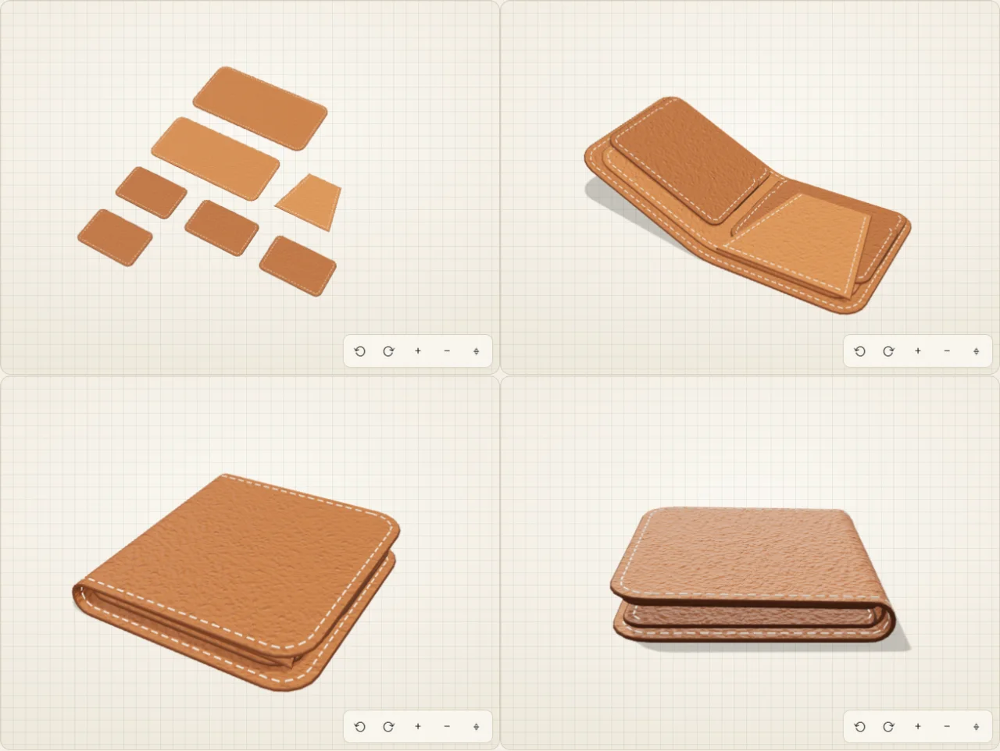
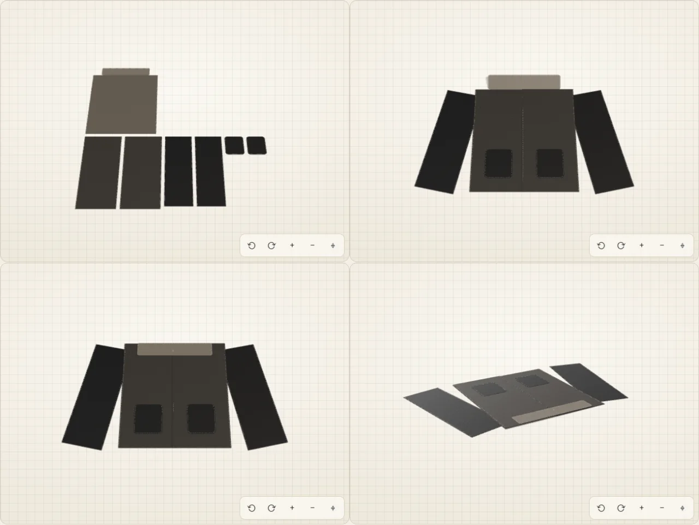
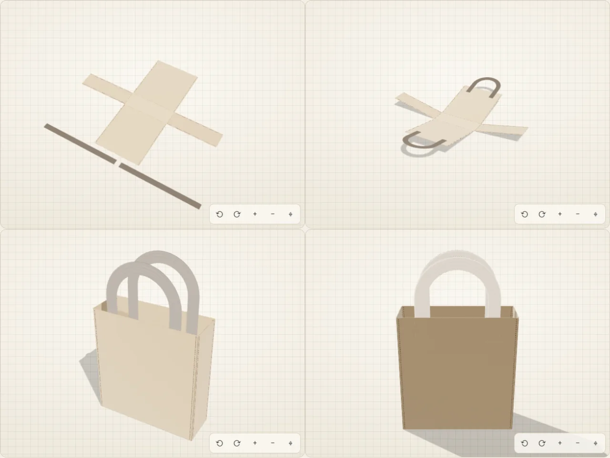
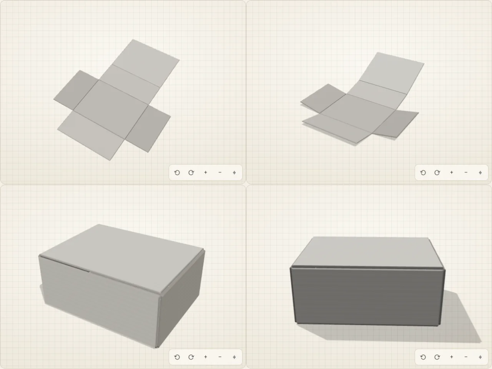

# 3D assembly preview

After [Hilo](agent.md), the design agent, proposes the flat pieces for a product, CutSense can show how those pieces become the object: a wallet folding shut, pockets landing on a cardholder, the walls of a box standing up, the sleeves of a jacket hanging from its shoulders. The preview is built from the real piece sizes, so what you see is a consequence of what you are about to cut. It is labelled **Approximate preview** and is never a technical drawing.

- Component: `src/components/AssemblyPreview.tsx` (styles in `AssemblyPreview.css`)
- Scene language, validator, macros, kinematics, checks: `src/lib/assembly/`
- three.js renderer, loaded on demand: `src/viewer3d/`
- Server routes: `server/assembly.ts` (`POST /api/assembly`, `POST /api/assembly/critique`, `POST /api/assembly/align`; contract in [api.md](api.md#3d-assembly-routes))
- Dev lab: `assembly-lab.html` (dev server only; see [development.md](development.md#the-dev-lab))

## How it works

1. **Rules first.** A deterministic scene is built at once from the product name and the piece names (an archetype macro such as `bifold_wallet`, `tote` or `garment_top`). It is the baseline every model answer is measured against, and what is shown if the model is unavailable.
2. **The model describes the assembly.** Muse Spark receives the product, the pieces and the design assumptions and returns a *scene*: structured data in a strict JSON Schema. It never returns code. The scene chooses placement, folds, layering, seams and hardware; every size comes from the pieces. It replaces the rules scene only if the deterministic checks score it no worse.
3. **The model checks its own work.** The app renders the assembled object from four angles (pieces painted in the cutting-plan colours) and sends the image, the scene and an automatic geometry report back. The model answers `ok` or a corrected scene. Up to two rounds; a correction is only accepted if it is not geometrically worse, and the loop stops early when a correction changes nothing.
4. **Verification.** If the deterministic checks still measure problems (a piece detached from the one it should be sewn to, a sleeve sticking out sideways, fronts that do not meet), one more call sends the scene, the render and exactly those problems, and asks for a corrected scene. The correction is kept only if it scores strictly better; when nothing is left to fix the call is skipped.
5. **Reveal.** The final scene is the best candidate by score. Only then does the 3D appear and play the assembly once.
6. **Assemble.** A slider (and a *See how it goes together* button) animates from the pieces lying flat, as cut, to the assembled object: stacked and sewn pieces travel onto their parent, then hinges and folds close and pouches fill out.

### Progress while the model works

While steps 2–4 run, the 3D view is covered by an opaque panel with a spinner, a percentage, a bar and the current step (*Modelling the assembly with AI…*, *Reviewing the model with AI (1/2)…*, *Checking that every piece fits…*, *Preparing the 3D preview…*). The viewer stays mounted underneath because it renders the images for the review; the camera controls and the *Assemble* slider are disabled until the reveal.

The percentage follows the calls actually made: the scene takes 0–34 %, the reviews 34–56 % and 56–74 %, the verification 74–94 % and the reveal 94–99 %. Finishing a step moves the bar to the start of the next one (a step that is skipped, such as a second review after an `ok`, is jumped over); within a step it only creeps toward 85 % of its share, so it never runs ahead of the work. The value never goes back and never passes 99 % before the 3D appears. If a call fails, the panel goes away and the best scene measured so far is shown with an honest note (*The AI did not answer; showing the rule-based assembly.*, *AI unavailable; showing the rule-based assembly.*, or *The AI review did not finish; showing the best assembly so far.*) and a *Retry with AI* link. A scene already computed for the same product and pieces is shown at once.

The panel is a `progressbar` with `aria-valuenow`, `aria-valuetext` and the step as its label; the step is also announced in the polite status line. With reduced motion the spinner and the bar do not animate.

## The scene language

A scene is a flat list of nodes with parent ids (the strict schema forbids recursion), plus a material, a camera suggestion and an optional macro.

| Field | Meaning |
|---|---|
| `type` | `panel` (a piece), `strap` (a handle drawn as an arc whose length is the piece length), `hardware` (`snap`, `stud`, `ring`, `zipper`, `rivet`, `buckle`) |
| `piece`, `instance` | Which cut piece this is. Each instance may be used once; unknown names are rejected. |
| `parent`, `joint` | `root` lies on the table; `stack` lies on a face (`side`) of the parent, with `layer` order and automatic stacking of overlapping siblings; `hinge` attaches by its bottom edge to a parent edge (`hinge_edge`) and turns by `hinge_angle_deg` (90 = wall, 180 = flap folded over); `seam` sews its bottom edge to a parent edge and stays in the parent's plane, swung by `rotation_deg` around the seam point (sleeves, hoods, waistbands, cuffs) |
| `anchor_x/y`, `self_x/y` | Fractions of the parent and of the piece itself: which point of the piece sits on which point of the parent |
| `folds` | Up to three folds of the piece itself: axis, position, angle (180 = shut, 350 = tube), which side moves, bend radius (automatic radius fits whatever is stacked inside) |
| `bulge_mm`, `stitch` | Cushioning for pouches; which edges carry visible stitches |

Every piece has a local frame: x along its width, y along its height (+y is the top edge as drawn), z through its thickness. Macros (`bifold_wallet`, `cardholder`, `card_slot_stack`, `zip_pouch`, `flap_pouch`, `flat_sleeve`, `envelope_flap`, `tube_sleeve`, `box_with_lid`, `tote`, `keychain_loop`, `coaster_stack`, `garment_top`, `generic_stack`) expand deterministically into these nodes from the real pieces, using roles assigned by the model or guessed from the piece names. The critique and the verification always see the expanded nodes, so they can edit them.

A `seam` piece meets its parent at the point `anchor_x` (top and bottom edges) or `anchor_y` (left and right edges) of `hinge_edge`. The point of the piece sewn there is `self_x` along its bottom edge, a seam allowance inside it (`self_y` moves it further in). With `rotation_deg` 0 the piece leaves the edge straight outward; other values swing it in the plane around that point. It is layered like a stacked piece, so `side: "bottom"` tucks it under the parent.

### Garments

`garment_top` lays a top garment (jacket, coat, shirt, vest, sweatshirt) flat and face up, as in a technical flat drawing:

- the **back** is the root; the **fronts** lie on it, aligned with the shoulder line, and meet at the centre (or cross over when together they are wider than the back);
- each **sleeve** is a `seam` on a side edge of the back, tucked under it so the side edge covers the cap from the shoulder down to the underarm, and hangs down 12° out from the vertical; its cap stays just below the shoulder line. Sleeves alternate left and right, and a sleeve drawn sideways (wider than tall) is turned so its short edge is the cap;
- the **collar** is hinged on the top edge of the back and folded down over the neckline; a **hood** is sewn above it, **waistbands** below the hem and **cuffs** at the end of the sleeves;
- **pockets** go low on the fronts, **flaps** cover them (or become lapels when there are no pockets), and the closure (zipper or a row of snaps) runs along the centre front;
- linings and anything else that fits lie on the back, under the fronts.

The product name picks the macro, in English or Spanish (*jacket, coat, vest, waistcoat, shirt, blouse, hoodie, sweater, garment…* as well as *chaqueta, campera, abrigo, blazer, chaleco, camisa, sudadera, jersey…*), and so does a piece set with sleeves. Piece names map to the garment roles *sleeve / manga* → `sleeve`, *collar / lapel / cuello* → `collar`, *cuff / puño* → `cuff`, *hood / capucha* → `hood`, *waistband / hem / ribbing / pretina / cinturilla / dobladillo* → `waistband`; these are only guessed for garments, so the "sleeve" of a phone case is still its body.

## Guardrails

- **No code from the model.** Output is data in a closed schema (Meta's strict subset: closed objects, every key required, no `oneOf`/`allOf`, depth ≤ 10). The renderer only interprets known fields.
- **Validation.** Numbers are clamped to safe ranges (angles, anchors, offsets, thickness 0.5–5 mm, ≤ 3 folds), at most 60 nodes, unknown pieces and repeated instances are dropped, a single root is enforced and cycles are broken. A structurally invalid answer, or one that leaves most pieces unplaced, gets one retry with the error; after that the server answers `ASSEMBLY_BAD_OUTPUT` and the rules-based preview stays.
- **Inputs.** Product name ≤ 120 characters; pieces re-validated with the agent's limits (≤ 6 types, 0.3–120 cm, quantity ≤ 50); critique images must be PNG, JPEG or WebP data URLs of ≤ 1.2 MB (optional for the verification, which can run on the geometry report alone); the geometry report is passed as data, flattened to one line; the verification takes 1–12 problems of ≤ 300 characters each.
- **Service limits.** 30 requests per minute per IP by default (`rateLimit` hook; one preview makes up to four calls), 90 s timeout per call, the API key stays on the server.
- **Deterministic checks.** Before and during the critique and the verification the app samples every piece in the assembled pose and measures:
  - pieces that pass through each other;
  - attachment: which pieces touch which (within a seam's reach); any piece that cannot be reached from the root through touching pieces is reported as floating, with its gap in cm; a piece that does not touch its own parent, or a hinge or seam that touches it at a single point, is reported as loose;
  - stacked pieces that overhang or sit mostly off their parent, seams placed outside their parent's edge, handles too short to reach, over-rolled folds and pieces left unplaced;
  - for garments, in the torso's own frame: each sleeve must be at the side of the body (not lying on it), sewn near the shoulder and hanging down (not sideways or upward), one on each side; the fronts must meet at the centre, the back must be behind them and the collar at the neckline.

  Each problem has a weight (pieces passing through each other or floating weigh most) and their sum is the scene's *penalty*. The pipeline keeps the candidate with the lowest penalty and never accepts a worse one.

## Accessibility and honesty

- The canvas has a text label, keyboard orbit (arrow keys, `+`/`−`, `Home`), on-screen camera buttons and a keyboard-operable *Assemble* slider with spoken values. With reduced motion the preview opens assembled and nothing animates on its own.
- *Model description* gives a text alternative generated from the scene (what sits on what, which edges are joined, approximate assembled size).
- The caption states the simplifications: uniform thickness, ideal folds, symbolic stitches and hardware, and lists any piece the scene could not place. Assumptions the model made about the assembly are listed below it.
- *By piece* paints each piece in its cutting-plan colour, so a piece in the 3D view can be matched to the plan.

## Known limits

- Folds are ideal cylindrical bends of a uniform sheet; leather compression, stretch and the material taken up by a fold are not modelled.
- Stitches and hardware are drawn as symbols at plausible positions; seam allowances are not represented.
- Gussets that wrap around corners, sewn-in linings and fabric drape are approximated by flat panels and hinges; soft bags look boxier than in real life.
- Pieces are rigid outside their folds. Shapes come from the five piece kinds the agent uses (rectangle, rounded rectangle, ellipse, trapezoid, L-shape).
- The critique judges a rendered image; it can miss problems hidden from the four views and may ask for things the scene language cannot express. The verification fixes what the checks can measure; a scene can pass every check and still look unlike the product.
- Garments are shown flat, as a technical drawing, not worn: no body volume, drape or sleeve tubes, and set-in sleeves are approximated by panels tucked under the armhole. Trousers, skirts and dresses have no archetype yet and fall back to the generic layout or the model's own scene.

## Integration

```tsx
import { AssemblyPreview } from './AssemblyPreview';

<AssemblyPreview productName={proposal.name} pieces={proposal.pieces} assumptions={proposal.assumptions} />
```

The component imports its own CSS and expects the brand stylesheet (`src/styles.css`) that the app already loads. `ai={false}` shows the rules-based preview only. The server routes are registered from `server/index.ts` with the same key and base URL as the design agent; no extra configuration is needed.

## Screenshots

`docs/3d-preview/` holds one sheet per product family from the lab (flat pieces, mid-assembly, assembled, second angle), rendered after the model and critique loop. File names are the fixture keys: `billetera` (bifold wallet), `tarjetero` (cardholder), `monedero` (coin purse), `gafas` (glasses case), `celular` (phone sleeve), `tote`, `llavero` (keychain), `posavasos` (coasters), `neceser` (toiletry bag), `caja` (box), `chaqueta` (jacket), plus `billetera-dark` for the dark theme.

| Bifold wallet | Jacket (`garment_top`) |
|---|---|
|  |  |
| **Tote** | **Box with lid** |
|  |  |
