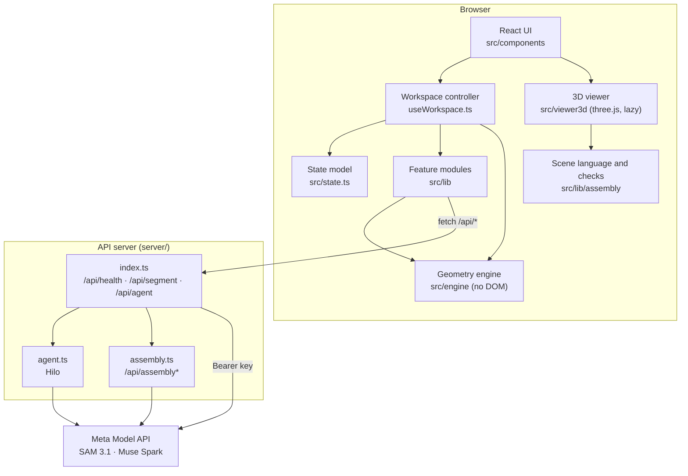

# Architecture

CutSense is a single-page React app (Vite, TypeScript) with a small Express API next to it. Almost everything runs in the browser: digitizing, nesting, verification, metrics, exports and project files. The server exists for one reason: to call the Meta Model API without ever exposing the API key to the browser.



## Modules

| Module | Responsibility | Depends on |
|---|---|---|
| `src/types.ts` | The shared contract: `Pt`, `Ring`, `Template`, `Problem`, `Placement`, `Solution`, `Metrics`, `Violation`, `VerifyResult`, `ContourSource`. | nothing |
| `src/engine/` | Pure geometry, usable in Node and the browser: `geometry.ts` (rings, rotation, simplicity, boolean ops via polygon-clipping, distances), `optimize.ts` (nesting), `maxkits.ts` (complete-set search), `verify.ts` (independent verifier), `metrics.ts`, `remainder.ts` (leftover), `templates.ts` (piece shapes and palette). Public API in `engine/index.ts`. | `polygon-clipping` |
| `src/state.ts` | The UI state model (`Project`, `Result`, `TemplateDef`, `Calib`), unit conversion (`pxPerUnit`, `unitLabel`), `buildProblem`, `problemKey`, piece labels and the "what changed" diff. | engine |
| `src/lib/` | Features built on the engine: mask → polygon (`mask.ts`), SAM client (`sam.ts`), kits (`kits.ts`), examples, custom pieces and SVG import, extra products on the leftover (`products.ts`), exports (`export.ts`, `print.ts`, `dxf.ts`), project files (`projectFile.ts`), Hilo's schema and client (`agentSchema.ts`, `agent.ts`), the Markdown subset, the shortfall diagnosis for Hilo, and the pure UI rules of the workspace (`workspaceUi.ts`). | engine, state |
| `src/lib/assembly/` | The 3D scene language (`dsl.ts`), validation, archetype macros, kinematics, sanity checks, text description, deterministic fallback, API client. | agent schema |
| `src/viewer3d/` | three.js renderer, imported on demand so the 3D code is not in the main bundle. | three, assembly |
| `src/components/` | React UI. `Home` (photo, examples, open project), `Workspace` (canvas + one panel), `Stage` (the SVG canvas), `AgentDialog` (Hilo), `PieceDialog` (draw/import a piece), `AssemblyPreview` (3D). `workspace/useWorkspace.ts` holds all workspace state and handlers; the panels only present values and call handlers. | everything above |
| `server/` | `index.ts` (routes, SAM proxy, env vars, Hilo rate limit), `agent.ts` (Hilo), `assembly.ts` (3D routes). Shares the agent schema and assembly validation with the client by importing them from `src/lib`. | express, `@meta-sam/parser` |

## Data flow

1. **Photo.** `App.tsx` accepts JPG, PNG or WebP up to 10 MB, decodes it and downscales it to at most 1600 px on the long side. It becomes `Project.image` (a data URL plus its pixel size).
2. **Outline.** `lib/sam.ts` downscales again to 1024 px and posts to `/api/segment`. The server streams the SAM response, decodes the one-bit mask and returns a cropped raster. `lib/mask.ts` keeps the largest connected component, fills it, traces its outer boundary (Moore neighbourhood with Jacob's stopping criterion), simplifies it (Douglas–Peucker) and maps it back to image pixels. Interior holes larger than 0.3 % of the material are returned as candidate excluded zones. The proposal is shown dashed until you accept it.
3. **Excluded zones.** Drawn polygons, quick circles, mask holes, or SAM detections. SAM detections are filtered (too small, more than 40 % of the material, centroid outside the material or inside an existing zone) and stay proposals until accepted.
4. **Calibration.** By width (the outline's bounding box width equals *N* cm) or two points on a known length. Calibrating rescales every piece so that it keeps its size on the photo.
5. **Pieces.** `TemplateDef`s from kits, basic shapes, custom shapes or an approved Hilo proposal.
6. **Problem.** `buildProblem` converts the project into an engine `Problem` in image pixels: material ring, defect rings, templates (`toTemplate` builds the shape at the right pixel size), spacing in pixels, `seed: 1`, `timeLimitMs: 4000`.
7. **Plan.** `optimizeAsync` (fixed order) or `maximizeKitsAsync` (complete sets) runs on the main thread, yielding to the event loop about every 50 ms and reporting progress. Every candidate goes through `verifySolution`; the stored `Result` also keeps the verifier's output.
8. **Result.** Metrics, labels, the leftover (computed when the Leftover tab opens), extra products, the "what changed" diff against the previous plan, and exports.

## Units

| Space | Where | Meaning |
|---|---|---|
| Image pixels | Engine, `Problem`, `Placement.polygon`, contour, defects | All geometry is computed here. |
| Display units | `TemplateDef.w/h`, `Project.spacing`, everything shown in the panel | Relative **u** without calibration, or the calibrated unit. |
| Relative **u** | Uncalibrated projects | `1 u = 1 %` of the image width (`pxPerUnit(null, w) = w / 100`). Never presented as centimetres. |
| Calibrated **cm / mm** | Calibrated projects | `pxPerUnit = distance in px between the two points / real distance`. Any unit string is accepted for two-point calibration; physical features check for `cm` or `mm`. |
| Real centimetres | Kits, Hilo, extra products, 1:1 print, SVG in cm | Require a calibration in **cm** (kits, Hilo, extra products) or **cm/mm** (print, SVG in cm, DXF). |
| Millimetres | DXF | `pxPerCm` × 10, origin at the bottom-left of the material's bounding box, Y up. |

Without calibration the app still optimizes, but kits are blocked with a clear reason, and physical exports are disabled.

## State model

```ts
interface Project {            // what you are editing (saved in the project file)
  image: ImageInfo | null;     // data URL, pixel size, name, example id
  contour: Ring;               // material outline in image pixels
  lastValid: Ring;             // last outline without self-intersections ("revert")
  source: ContourSource | null;// 'sam' | 'example' | 'local' | 'manual' | 'leftover'
  edited: boolean;             // corrected by hand after an AI/example/local proposal
  samInfo: string | null;      // model · latency · confidence · prompt
  defects: Ring[];             // excluded zones in image pixels
  calib: Calib | null;         // two points, real distance, unit
  defs: TemplateDef[];         // the order, in display units
  spacing: number;             // minimum spacing, display units
  fill: 'fixed' | 'maxKits';   // place the order as is, or maximize complete sets
}

interface Result {             // a computed plan
  solution: Solution;          // placements, metrics, elapsedMs, optimizerVersion, seed
  verify: VerifyResult;        // independent verification of exactly these placements
  problemKey: string;          // fingerprint of the inputs that produced it
  kits?: { n; perKit };        // complete sets placed and pieces per set (maxKits)
  extras?: ExtraProduct[];     // products added on the leftover, after the main order
  ppu: number; unit: string; calibrated: boolean;
  problem: Problem;            // the exact (expanded) problem that was verified
}
```

**Staleness.** `problemKey` is a JSON fingerprint of the problem and the calibration, plus the fill mode. When you change anything after optimizing, the current key no longer matches the result's key: the plan is marked *out of date*, drawn greyed, and cannot be exported until you re-optimize. After re-optimizing, `diffResults` lists what changed (zones, outline, order, spacing, pieces placed) and how many pieces moved.

**Extra products.** `addProduct` plans another kit or single piece on the leftover: the placed pieces become obstacles, `maximizeKitsAsync` searches how many sets fit, and the combined problem (main order + extra templates) is verified as a whole. Extra template ids are prefixed (`x1_t0`, …) so they never collide with the order's ids. `removeProduct` filters an extra out and re-verifies.

## Why the AI proposes and deterministic code decides

- **Trust.** A plan you cut from must be valid. Validity is a geometric fact that code can check exactly, so it is checked by code, every time, by a verifier that shares no placement logic with the optimizer.
- **Reproducibility.** The same input and seed give the same plan. That is only possible if placement is deterministic; model output is not.
- **Clear provenance.** Each element on the canvas says where it came from (AI proposal, your correction, computed, verified, out of date) with a line style, a word and a colour. Users can see which parts to double-check.
- **Graceful degradation.** Every AI step has a non-AI path: local segmentation, saved masks and manual tracing for the outline; drawn zones for defects; kits and hand-made pieces for the order; a rules-based scene for the 3D preview.
- **Bounded influence.** Model output enters the app only as validated data within tight ranges (sizes, counts, enums), and only after you approve it.

## Server

The server is intentionally thin: one Express app, a 12 MB JSON body limit, three groups of routes and no storage. See [api.md](api.md) for the contract. It imports `validateTurn` and the scene validator from `src/lib`, so the client and the server enforce the same rules.
